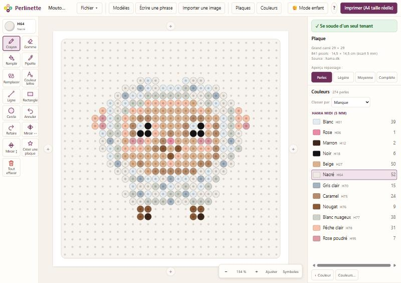

  

<h1 align="center">Perlinette</h1>

<b>Créer, préparer et imprimer des motifs de perles à repasser</b> 
Hama · Perler · Artkal — gratuit, en français, sans compte et sans installation.

  <a href="https://sophiegarguilo-star.github.io/perlinette/"><b>Présentation et tutoriels</b></a> ·
  <a href="https://github.com/sophiegarguilo-star/perlinette/archive/refs/heads/main.zip"><b>Télécharger</b></a>

## Ce que fait Perlinette

- **Les vraies plaques** : grand et petit carré, hexagones, ronds (picots en anneaux), Mini et Maxi — et tes propres plaques (cœur, étoile…) que tu dessines toi-même.
- **Assemblages** : ajoute une plaque à gauche, à droite, en haut ou en bas ; le dessin reste en place.
- **Dessin** : crayon, gomme, remplissage, pipette, remplacer une couleur, ligne / rectangle / cercle (pleins ou évidés), **sélection avec copier / couper / coller** (même d’un motif à l’autre), miroirs, annuler.
- **Nuanciers complets** de Hama (Midi, Mini, Maxi), Perler et Artkal, avec les **noms en français**, et **« Mes perles »** : les couleurs que tu as chez toi, avec le stock.
- **Vérification de soudure** : Perlinette signale les perles qui ne tiendraient pas au repassage (perle isolée, tenue seulement par un coin).
- **Aperçu du repassage** : fusion légère, moyenne ou complète.
- **Plus de 400 modèles dessinés perle par perle**, chacun pour sa plaque : simples et francs pour la Maxi des petits, petits sujets pour le petit carré, personnages et objets en entier pour le grand carré, grands dessins détaillés pour la Mini. Thèmes : animaux, fruits et légumes, plantes et fleurs, gourmandises, snacks du monde, boissons, mer et océan, ciel et météo, kawaii, mode et accessoires, amour et mariage, plage et vacances, camping et nature, voyage et monuments, musique, école, sport, véhicules, course de karts (un kit de pièces qui se raccordent pour créer un niveau au mur), saisons, Halloween, Noël, Pâques, emoji, mandalas, plus l'alphabet, les chiffres et les signes.
- **Écrire une phrase** : un prénom ou un mot en lettres avec relief, sur le moins de plaques possible, avec des jeux de couleurs prédéfinis.
- **Importer une image** et la transformer en motif, avec seulement les couleurs que tu possèdes.
- **Impression A4 à taille réelle**, pour poser une plaque transparente directement sur la feuille : aperçu, légende des couleurs, logo, plusieurs plaques par feuille, repères d'assemblage.
- **Mode enfant** : quatre gros outils et de grandes pastilles de couleur.

## Démarrer

1. [Télécharge Perlinette](https://github.com/sophiegarguilo-star/perlinette/archive/refs/heads/main.zip) et décompresse le dossier.
2. **Windows** : double-clique sur `Perlinette.bat`.
   **Mac / Linux** : ouvre `index.html` avec ton navigateur (Chrome, Edge, Firefox, Safari).
3. C'est tout : rien à installer, aucune connexion Internet nécessaire.

> Tes motifs sont enregistrés dans le navigateur. Pense à faire **Fichier → Exporter un fichier** de temps en temps : c'est ta vraie sauvegarde, que tu peux ranger où tu veux.

Les tutoriels pas à pas sont sur la [page de présentation](https://sophiegarguilo-star.github.io/perlinette/tutoriels.html).

## Imprimer à la bonne taille

Dans la fenêtre d'impression du navigateur, choisis **« Taille réelle » / 100 %**, jamais « Ajuster à la page ». Un trait en bas de chaque feuille doit mesurer exactement **5 cm** : c'est la vérification.

## Crédits

Voir [CREDITS.md](CREDITS.md) (nuanciers, sources des plaques, marques).

## Licence

Perlinette est un logiciel libre, sous licence [GNU AGPL v3](LICENSE).
© 2026 Sophie Garguilo.
